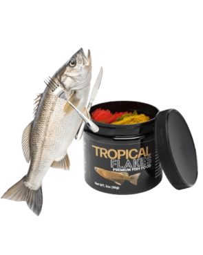

# fish-flake

A fish plugin for [Nix flake](https://nixos.wiki/wiki/flakes) workflows with optional [direnv]() support.

### Installation

Install with [fisher](https://github.com/jorgebucaran/fisher):

```shell
fisher install givensuman/fish-flake
```

### Usage

`flake init`

Initializes a workspace in the current directory

```bash
flake init github:nixos/templates#python
flake init # defaults to "$flake_default"
flake init python # defaults to "$flake_default_repository#python"
```

`flake clean`

Cleans `direnv` cache and runs `nix-collect-garbage`

`flake list`

Lists packages used in current workspace

`flake status`

Status information for the current workspace

`flake update`

Updates the Nix lockfile and reloads the workspace

### Environment variables

| Variable | Description | Default |
| ------------- | ------------------------------------------ | ----------------------------------------------------------------------------------------- |
| flake_default | flake to use if none is specified with `init` | "github:nixos/templates#utils-generic" |
| flake_default_repository | repository to use if none is specified with `init` | "github:nixos/templates" |


Check out [givensuman/nix-templates](https://github.com/givensuman/nix-templates) as an option to consider.

### Additional

You can modify your prompt to indicate whether or not you're in a workspace. Here's what my `config.fish` looks like in conjunction with [jorgebucaran/hydro](https://github.com/jorgebucaran/hydro) and with [Nerd Fonts](https://www.nerdfonts.com/):

```fish
set --local symbol " "
if set -q DIRENV_DIR; and test -f flake.nix
  set --local symbol "$symbol  "
end

set --global hydro_symbol_prompt "$symbol"
```

### Requirements

Requires the `nix` command with with `experimental-features = nix-command flakes` set. `direnv` is optional but recommended!

### License

[MIT](./LICENSE)
